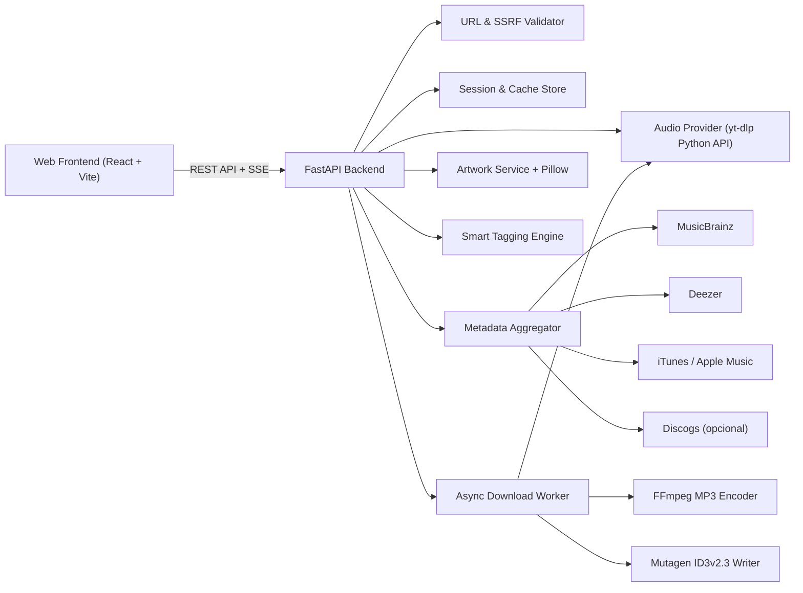
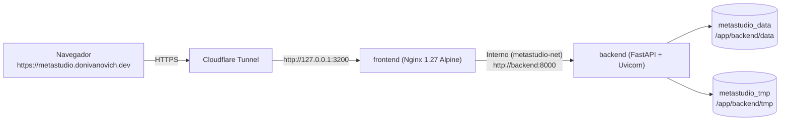

# Arquitectura de MetaStudio Music Downloader

## 1. Visión General (Cliente-Servidor)

**MetaStudio Music Downloader** sigue una arquitectura cliente-servidor estricta:

- **Frontend (SPA web — React + TypeScript + Vite + Tailwind CSS v4 + Lucide)**: Es el producto principal y único punto de interacción del usuario. Implementa el diseño oscuro minimalista de tres columnas inspirado en la referencia de Lovable (`pixel-perfect-picture-0355.lovable.app`).
- **Backend (Motor Python — FastAPI + yt-dlp + FFmpeg + Mutagen + Pillow)**: Ejecuta toda la lógica multimedia, extracción de URLs, búsqueda en APIs musicales, clasificación inteligente de etiquetas, conversión a MP3, escritura ID3 y empaquetado ZIP.

Ambos procesos pueden ejecutarse y desplegarse de forma independiente comunicándose mediante REST API (`/api/v1/*`) y **Server-Sent Events (SSE)** para progreso asíncrono en tiempo real.

---

## 2. Separación de Proveedores

Para no simular compatibilidad inexistente y respetar DRM y términos de servicio:

1. **Proveedores de Audio (`backend/services/downloader/`)**:
   - Utilizan la API Python de `yt-dlp` (nunca comandos de shell concatenados).
   - Soportan YouTube, YouTube Music y otras fuentes abiertas soportadas por `yt-dlp`.
   - Enlaces de Apple Music o Deezer **no** descargan audio directamente desde dichas plataformas protegidas por DRM; en su lugar, se identifican claramente como fuentes de metadatos (o informan con claridad si no existe fuente de audio descargable autorizada).
2. **Proveedores de Metadatos y Carátulas (`backend/services/metadata/`, `backend/services/artwork/`)**:
   - **MusicBrainz + Cover Art Archive** (abierto, rate-limited 1 req/s).
   - **Deezer Public Search API** (abierto, devuelve metadatos, carátulas `1000×1000` y previsualización autorizada de 30s).
   - **iTunes / Apple Music Search API** (abierto, devuelve metadatos, género original, carátulas hasta `1400×1400`/`3000×3000` y previsualización autorizada de 30s).
   - **Discogs API** (adaptador real activable con `DISCOGS_TOKEN`).

---

## 3. Carga Diferida (Lazy Loading) de Playlists

1. Al enviar una URL de playlist a `POST /api/v1/analyze`, `yt-dlp` ejecuta extracción ligera (`extract_flat="in_playlist"`, `skip_download=True`).
2. Se crea una sesión aislada con la lista de entradas en estado `pending`.
3. Únicamente la **primera canción** (índice 0) se enriquece automáticamente (metadatos completos, fuentes musicales, carátulas, lectura de género/idioma original y sugerencia de etiquetas).
4. Al navegar a cualquier otra canción (`POST /api/v1/sessions/{sid}/tracks/{tid}/process`), se procesa bajo demanda y se almacena en caché en la sesión para no reprocesarla.
5. Al solicitar **Descargar playlist completa**, la cola procesa de manera controlada y con concurrencia configurable (`PLAYLIST_DOWNLOAD_CONCURRENCY=2`) las pistas aún en estado `pending`.

---

## 4. Decisiones Técnicas Clave

### 4.1. Metadatos ID3 (`ID3v2.3`)
- Se utiliza **Mutagen** escribiendo **ID3v2.3** (`v2_version=3`, codificación UTF-16).
- **Motivo**: ID3v2.3 es el estándar con máxima compatibilidad real entre Windows Explorer, macOS Finder/Music, iOS, Android, VLC, Rekordbox y reproductores embebidos, a diferencia de ID3v2.4 que algunos sistemas nativos de Windows aún leen de forma parcial.
- **Limpieza estricta**: Antes de escribir, se eliminan **todos** los frames ID3 existentes (`delete()`).
- **Frames permitidos (exclusivamente 4)**:
  1. `TIT2` — Nombre de la canción.
  2. `TPE1` — Artistas separados por `, ` (coma y espacio).
  3. `TALB` — Álbum (con fallback automático al título cuando no hay álbum válido).
  4. `APIC` — Carátula frontal (`type=3`, `mime=image/jpeg` o `image/png`, procesada con Pillow).
- Ningún otro campo (`TCON`, `TLAN`, `TDRC`, `TRCK`, `COMM`, `TXXX`, etc.) se escribe jamás en el MP3 final.

### 4.2. Regla de Álbum y Artistas
- Si no existe álbum válido, `album` hereda automáticamente `title` y marca `album_auto_synced=True`.
- Si el usuario cambia `title` mientras `album_auto_synced=True`, `album` se actualiza automáticamente.
- En cuanto el usuario edita `album` manualmente, `album_auto_synced` pasa a `False` y no vuelve a sobrescribirse.
- Los artistas se almacenan internamente como `artists_list: list[str]` (para preservar comas legítimas en nombres de artistas cuando la API provee entidades separadas) y se renderizan/exportan unidos por `, `.

### 4.3. Formato de Nombre de Archivo
- Regla estricta: `nombrecancion_primerartista.mp3`
- Minúsculas, normalización ASCII/Unicode segura (sin tildes ni caracteres incompatibles de sistema de archivos), espacios y separadores colapsados en `_`, exclusivamente el primer artista de `artists_list`.
- Deduplicación automática en ZIP o carpeta de salida (`_2`, `_3`) sin alterar los metadatos ID3 internos.

### 4.4. Seguridad y Aislamiento
- Validación estricta de URLs (solo esquemas `http`/`https`, bloqueo de IPs privadas/loopback/link-local/metadata para prevención SSRF).
- Sin invocaciones de shell con entrada de usuario (`yt-dlp` vía librería Python; `ffmpeg` vía API de postprocesador / lista segura de argumentos).
- Validación de imágenes subidas con Pillow (verificación de formato real, dimensiones, límites de tamaño y re-codificación limpia).
- Aislamiento por `session_id` (UUID v4 validado estrictamente) para todos los archivos temporales y descargas.
- Rate limiting básico por IP y limpieza automática de descargas fallidas/incompletas.

---

## 5. Inventario de Módulos

| Módulo | Responsabilidad | Ubicación |
| --- | --- | --- |
| Configuración | Variables de entorno, límites, ruta FFmpeg | `backend/config/settings.py` |
| Seguridad / URL | Validación URL, detección plataforma, protección SSRF | `backend/utils/url_validator.py` |
| Sanitización de nombres | Generación `nombrecancion_primerartista.mp3` | `backend/utils/filename.py` |
| Modelos de dominio | Sesiones, pistas, cola, trabajos, etiquetas | `backend/models/domain.py` |
| Esquemas API | Contratos Pydantic request/response | `backend/schemas/api.py` |
| Almacén y caché | Sesiones aisladas, caché de metadatos/carátulas, persistencia de etiquetas | `backend/services/storage/store.py` |
| Motor FFmpeg | Detección, verificación y ruta de FFmpeg | `backend/services/audio/ffmpeg_service.py` |
| Escritor ID3 | Lectura de metadatos originales + escritura estricta de 4 frames | `backend/services/audio/id3_service.py` |
| Proveedor de audio | Extracción ligera/completa y descarga MP3 con `yt-dlp` | `backend/services/downloader/ytdlp_service.py` |
| Proveedores musicales | MusicBrainz, Deezer, iTunes, Discogs + scoring | `backend/services/metadata/` |
| Servicio de carátulas | Búsqueda agregada, descarga segura, validación/procesado Pillow | `backend/services/artwork/artwork_service.py` |
| Catálogo y clasificación | Catálogo versionado de etiquetas + inferencia por género/idioma | `backend/services/classification/` |
| Orquestador y cola | Procesamiento lazy, cola de descarga, SSE, generador ZIP | `backend/workers/download_manager.py` |
| Endpoints REST & SSE | Rutas organizadas `/api/v1/*` | `backend/api/` |
| Frontend SPA | Interfaz de 3 columnas, reproductor, editor, fuentes, cola | `frontend/src/` |
| Contenedor Backend | Imagen Python 3.12 + FFmpeg nativo, usuario no-root (`appuser`) y healthcheck | `backend/Dockerfile` |
| Contenedor Frontend & Proxy | Build multi-stage Node 22 → Nginx 1.27 Alpine con cabeceras de seguridad, SSE y proxy `/api/` | `frontend/Dockerfile`, `frontend/nginx.conf` |
| Orquestación Producción | Imágenes GHCR ARM64/AMD64, backend estrictamente interno, frontend `127.0.0.1:3200`, `no-new-privileges`, rotación de logs | `docker-compose.prod.yml` |
| Orquestación Desarrollo | Build local con puertos configurables y lanzadores de puerto estable | `docker-compose.yml`, `scripts/docker-up.{sh,ps1}`, `.dockerignore` |

---

## 6. Endpoints de la API (`/api/v1/*`)

Todas las peticiones del frontend se realizan al mismo origen (`/api/v1/*`) y Nginx las enruta internamente hacia `http://backend:8000`:

| Método | Ruta | Descripción |
| --- | --- | --- |
| `GET` | `/api/v1/health` | Estado del servicio, verificación de FFmpeg, versión de `yt-dlp` y proveedores activos |
| `POST` | `/api/v1/analyze` | Analiza una URL (canción o playlist con `extract_flat`) y crea sesión aislada (procesa solo pista 0) |
| `GET` | `/api/v1/sessions/{sid}` | Obtiene el estado completo de la sesión y su cola de descarga |
| `GET` | `/api/v1/sessions/{sid}/tracks/{tid}` | Obtiene el estado actual de una canción concreta |
| `POST` | `/api/v1/sessions/{sid}/tracks/{tid}/process` | Procesamiento bajo demanda (*lazy loading*) de metadatos, carátulas y etiquetas (`?force=true` para reintento) |
| `PATCH` | `/api/v1/sessions/{sid}/tracks/{tid}/metadata` | Actualiza los 4 campos ID3 permitidos (`title`, `artists`/`artists_text`, `album`, `selected_artwork_id`) |
| `POST` | `/api/v1/sessions/{sid}/tracks/{tid}/apply-candidate` | Aplica todos o campos concretos (`title`, `artists`, `album`) de un proveedor normalizado |
| `DELETE` | `/api/v1/sessions/{sid}/queue` | Limpia por completo la cola de descarga sin alterar la playlist original |
| `DELETE` / `POST` | `/api/v1/sessions/{sid}/queue/{tid}` | Quita o devuelve una canción concreta en la cola de descarga |
| `POST` | `/api/v1/sessions/{sid}/tracks/{tid}/artwork/search` | Re-ejecuta la búsqueda independiente de metadatos y carátulas con el título/artistas actuales |
| `POST` | `/api/v1/sessions/{sid}/tracks/{tid}/artwork/upload` | Sube, valida con Pillow y almacena una carátula personalizada aislada por sesión |
| `GET` | `/api/v1/sessions/{sid}/artwork/{filename}` | Sirve una carátula personalizada de la sesión |
| `GET` / `POST` | `/api/v1/tags/catalog` | Consulta o amplía el catálogo versionado de etiquetas de idioma y estado de ánimo |
| `GET` / `PUT` | `/api/v1/sessions/{sid}/tracks/{tid}/tags` | Consulta sugerencias o guarda etiquetas seleccionadas en `backend/data/track_tags.json` |
| `POST` | `/api/v1/sessions/{sid}/tracks/{tid}/download` | Inicia trabajo asíncrono de descarga y exportación ID3v2.3 para una canción |
| `POST` | `/api/v1/sessions/{sid}/download-playlist` | Inicia descarga controlada por concurrencia de toda la cola y empaquetado ZIP |
| `GET` | `/api/v1/jobs/{job_id}` | Consulta snapshot del estado de un trabajo de descarga |
| `POST` | `/api/v1/jobs/{job_id}/cancel` | Cancela un trabajo de descarga activo |
| `GET` | `/api/v1/jobs/{job_id}/events` | Stream **Server-Sent Events (SSE)** en tiempo real (`text/event-stream`, sin buffering) |
| `GET` | `/api/v1/sessions/{sid}/tracks/{tid}/file` | Descarga el MP3 exportado y etiquetado |
| `GET` | `/api/v1/jobs/{job_id}/zip` | Descarga el archivo ZIP con toda la playlist exportada |

---

## 7. Despliegue Contenerizado en Producción (Raspberry Pi 5 + Cloudflare Tunnel)

MetaStudio se ejecuta en producción en `/opt/docker/apps/MetaStudio` sobre una **Raspberry Pi 5 (16 GB, Raspberry Pi OS Lite 64-bit)** utilizando `docker-compose.prod.yml`:

- **`frontend` (Nginx 1.27 Alpine)**: Publicado únicamente en `127.0.0.1:3200:80` para recibir tráfico desde Cloudflare Tunnel. Sirve la SPA compilada, añade cabeceras de seguridad, preserva `X-Forwarded-Proto` y `CF-Connecting-IP`, y hace proxy de `/api/*` y `/api/v1/jobs/<id>/events` (SSE sin buffering ni gzip, timeout `3600s`) hacia `http://backend:8000`.
- **`backend` (Python 3.12 Slim + FFmpeg)**: **Sin puerto publicado en el host** (`expose: ["8000"]` interno en `metastudio-net`). Corre como usuario no-root (`appuser`), con `no-new-privileges:true`, rotación de logs y rate-limiting por IP real (respetando `CF-Connecting-IP` y `X-Forwarded-For`).

Consulta la guía operativa completa (Cloudflare Tunnel, healthchecks, logs, diagnóstico, actualizaciones y backups) en [docs/DOCKER.md](DOCKER.md).
