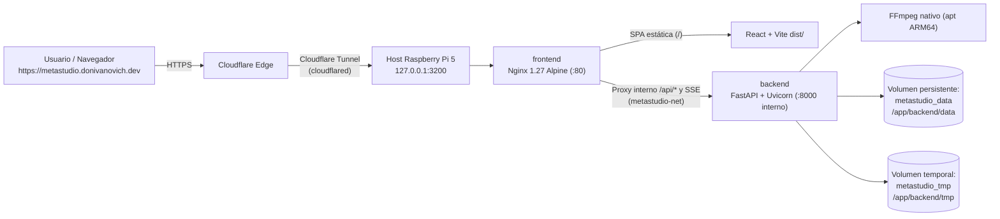

# Guía de Despliegue Docker y Producción (Raspberry Pi 5 + Cloudflare Tunnel)

Esta guía documenta la configuración real de **MetaStudio Music Downloader** tanto en **producción** (Raspberry Pi 5 de 16 GB con Raspberry Pi OS Lite 64-bit, Docker Compose y Cloudflare Tunnel) como en **desarrollo local con Docker**.

> **Sin dependencias en el host:** En producción con contenedores **no es necesario instalar Python, Node.js, npm ni FFmpeg en el sistema operativo host**. Todo se ejecuta aislado dentro de Docker.

---

## 1. Arquitectura Real de Producción

- **Servidor**: Raspberry Pi 5 (16 GB RAM, Raspberry Pi OS Lite 64-bit / `linux/arm64`)
- **Directorio de producción**: `/opt/docker/apps/MetaStudio`
- **Dominio público**: `https://metastudio.donivanovich.dev`
- **Acceso público**: Cloudflare Tunnel (`cloudflared`) → `http://localhost:3200` → contenedor `frontend` (Nginx)
- **Backend FastAPI**: **Estrictamente interno** en la red Docker `metastudio-net` (`http://backend:8000`). **No publica ningún puerto en el host.**



### Separación Producción vs Desarrollo

| Archivo Compose | Uso | Imágenes | Puerto Frontend | Puerto Backend |
| --- | --- | --- | --- | --- |
| `docker-compose.prod.yml` | **Producción (Raspberry Pi 5)** | Precompiladas multi-arch (`linux/arm64`, `linux/amd64`) desde **GHCR** | `127.0.0.1:3200:80` (solo loopback para Cloudflare Tunnel) | **Ninguno publicado** (solo interno `expose: 8000`) |
| `docker-compose.yml` | **Desarrollo / build local** | Compiladas localmente desde `backend/Dockerfile` y `frontend/Dockerfile` | `0.0.0.0:${FRONTEND_PORT:-8080}:80` | `0.0.0.0:${BACKEND_HOST_PORT:-8000}:8000` (Swagger `/docs` en local) |

### Decisiones Clave de Contenerización y Seguridad

- **Backend sin puerto público en producción**: Toda comunicación hacia `/api/v1/*` entra por Nginx en `frontend` y viaja internamente por `metastudio-net` hacia `http://backend:8000`.
- **Loopback-only en el frontend de producción**: `127.0.0.1:${FRONTEND_PORT:-3200}:80` asegura que el contenedor solo escuche en la interfaz local para `cloudflared`, sin abrir puertos al resto de la red ni a Internet.
- **Privilegios mínimos**: El contenedor `backend` corre como usuario no-root (`appuser`, UID `1000`) y ambos servicios activan `security_opt: ["no-new-privileges:true"]`.
- **Rotación de logs**: `json-file` limitado a `10m` × `3` archivos por contenedor para proteger el almacenamiento de la Raspberry Pi.
- **Proxy Nginx preparado para Cloudflare Tunnel y SSE**: `frontend/nginx.conf` preserva `X-Forwarded-Proto` (`https`), reenvía `CF-Connecting-IP` (usado por `RateLimitMiddleware` en FastAPI para aislar el límite de peticiones por visitante real), añade cabeceras de seguridad (`X-Content-Type-Options`, `X-Frame-Options`, `Referrer-Policy`, `Permissions-Policy`), permite subidas de carátulas hasta `30m` y desactiva `proxy_buffering`/`gzip` con timeout de `3600s` en `/api/v1/jobs/<id>/events`.
- **FFmpeg nativo**: `backend/Dockerfile` instala `ffmpeg` (y `ffprobe`) vía `apt-get` y fija `FFMPEG_PATH: ""` en Compose para autodetectar `/usr/bin/ffmpeg` (`source: "system_path"`).
- **Worker único asíncrono**: Uvicorn corre con 1 worker asíncrono para mantener coherencia de sesiones, cola de descargas y suscriptores SSE.

---

## 2. Despliegue en Producción (Raspberry Pi 5 — `/opt/docker/apps/MetaStudio`)

### Requisitos en Raspberry Pi OS Lite (64-bit)

Solo se necesita **Docker Engine** y el plugin **Docker Compose v2** (`docker compose`):

```bash
curl -fsSL https://get.docker.com | sh
sudo usermod -aG docker "$USER"
newgrp docker
docker --version && docker compose version
```

### Puesta en marcha inicial

```bash
sudo mkdir -p /opt/docker/apps/MetaStudio
sudo chown -R "$USER:$USER" /opt/docker/apps/MetaStudio
cd /opt/docker/apps/MetaStudio

# Clonar repositorio (o copiar docker-compose.prod.yml y .env)
git clone https://github.com/donivanovich/MetaStudio.git .
cp .env.example .env
```

Ajusta `.env` para producción en `/opt/docker/apps/MetaStudio/.env`:

```env
FRONTEND_PORT=3200
CORS_ORIGINS=https://metastudio.donivanovich.dev,http://localhost:3200,http://127.0.0.1:3200
AUDIO_MP3_BITRATE=320
PLAYLIST_DOWNLOAD_CONCURRENCY=2
MAX_ARTWORK_UPLOAD_MB=10
RATE_LIMIT_PER_MINUTE=60
DISCOGS_TOKEN=
```

Descarga las imágenes ARM64 precompiladas de GHCR y levanta los servicios:

```bash
# Solo si los paquetes GHCR son privados:
# echo "<PAT_READ_PACKAGES>" | docker login ghcr.io -u donivanovich --password-stdin

docker compose -f docker-compose.prod.yml pull
docker compose -f docker-compose.prod.yml up -d
```

Ambos contenedores incluyen `restart: unless-stopped`, por lo que arrancan automáticamente al reiniciar la Raspberry Pi 5.

---

## 3. Configuración de Cloudflare Tunnel

En el panel de **Cloudflare Zero Trust → Networks → Tunnels** (o en el `config.yml` local de `cloudflared`), el *Public Hostname* debe apuntar a la dirección local publicada por el contenedor `frontend`:

| Campo | Valor |
| --- | --- |
| **Public Hostname** | `metastudio.donivanovich.dev` |
| **Service Type** | `HTTP` |
| **URL** | `localhost:3200` (`http://127.0.0.1:3200`) |

Ejemplo equivalente si gestionas `cloudflared` mediante archivo local `/etc/cloudflared/config.yml`:

```yaml
ingress:
  - hostname: metastudio.donivanovich.dev
    service: http://127.0.0.1:3200
  - service: http_status:404
```

> **Nota sobre SSE y descargas ZIP en Cloudflare**: El endpoint de progreso en vivo (`/api/v1/jobs/<id>/events`) envía `Cache-Control: no-cache` y `X-Accel-Buffering: no`, además de keepalives periódicos cada 15 segundos para evitar desconexiones por inactividad.

---

## 4. Healthchecks, Logs y Diagnóstico

### Verificar estado y healthchecks

```bash
cd /opt/docker/apps/MetaStudio

# Estado y salud de ambos contenedores (deben aparecer como "healthy")
docker compose -f docker-compose.prod.yml ps

# Comprobar Nginx (frontend) en loopback
curl -fsS http://127.0.0.1:3200/healthz

# Comprobar comunicación interna frontend -> backend FastAPI + estado de FFmpeg
curl -fsS http://127.0.0.1:3200/api/v1/health
```

Respuesta esperada de `/api/v1/health`:

```json
{
  "status": "ok",
  "ffmpeg": { "available": true, "source": "system_path", "version": "...", "error": null },
  "yt_dlp_version": "...",
  "providers": { "musicbrainz": true, "deezer": true, "itunes": true, "discogs": false }
}
```

### Consultar logs

```bash
cd /opt/docker/apps/MetaStudio

# Logs en tiempo real de ambos servicios
docker compose -f docker-compose.prod.yml logs -f --tail=100

# Solo backend (extracción yt-dlp, FFmpeg, proveedores de metadatos)
docker compose -f docker-compose.prod.yml logs -f --tail=100 backend

# Solo frontend (Nginx access/error logs)
docker compose -f docker-compose.prod.yml logs -f --tail=100 frontend
```

### Diagnóstico rápido

```bash
# Verificar que SOLO 127.0.0.1:3200 está publicado y el backend NO tiene puerto en el host
docker compose -f docker-compose.prod.yml ps --format "table {{.Name}}\t{{.Status}}\t{{.Ports}}"

# Comprobar conectividad interna desde frontend hacia backend
docker compose -f docker-compose.prod.yml exec frontend wget -qO- http://backend:8000/api/v1/health

# Comprobar sintaxis de Nginx dentro del contenedor
docker compose -f docker-compose.prod.yml exec frontend nginx -t

# Ver uso de CPU y memoria en la Raspberry Pi 5
docker stats --no-stream
```

---

## 5. Actualizaciones Seguras (sin pérdida de datos)

> **IMPORTANTE:** Nunca ejecutes `docker compose down -v` en producción, ya que eliminaría los volúmenes persistentes (`metastudio_data` con las etiquetas guardadas y `metastudio_tmp`).

### Actualización automática (CI/CD)
Al integrar cambios en `main`, GitHub Actions ejecuta **CI** → publica nuevas imágenes `linux/amd64,linux/arm64` en **GHCR** → despliega en `/opt/docker/apps/MetaStudio` mediante `.github/workflows/cd-raspberry-pi.yml` (`pull` + `up -d` + verificación de salud + rollback automático).

### Actualización manual desde la Raspberry Pi 5

```bash
cd /opt/docker/apps/MetaStudio

# 1. Descargar nuevas imágenes sin detener aún los contenedores activos
docker compose -f docker-compose.prod.yml pull

# 2. Recrear únicamente los contenedores actualizados manteniendo volúmenes
docker compose -f docker-compose.prod.yml up -d --remove-orphans

# 3. Verificar salud tras actualizar
curl -fsS http://127.0.0.1:3200/healthz
curl -fsS http://127.0.0.1:3200/api/v1/health

# 4. Limpiar solo capas huérfanas antiguas (opcional)
docker image prune -f
```

---

## 6. Persistencia, Copias de Seguridad y Restauración

MetaStudio utiliza dos volúmenes Docker gestionados:

| Volumen | Ruta interna | Contenido | ¿Requiere backup? |
| --- | --- | --- | --- |
| `metastudio_data` | `/app/backend/data` | Etiquetas persistentes por canción (`track_tags.json`) y catálogo de etiquetas personalizadas (`custom_tags.json`). | **Sí (persistente)** |
| `metastudio_tmp` | `/app/backend/tmp` | Sesiones temporales, carátulas subidas, MP3 descargados y ZIPs generados. | No (efímero) |

### Crear copia de seguridad de `metastudio_data` (sin detener el servicio)

```bash
mkdir -p /opt/docker/backups/metastudio
docker run --rm \
  -v metastudio_metastudio_data:/data:ro \
  -v /opt/docker/backups/metastudio:/backup \
  alpine:3.21 \
  tar -czf "/backup/metastudio-data-$(date +%Y%m%d-%H%M%S).tar.gz" -C /data .
```

### Restaurar copia de seguridad

```bash
cd /opt/docker/apps/MetaStudio
docker compose -f docker-compose.prod.yml stop backend

docker run --rm \
  -v metastudio_metastudio_data:/data \
  -v /opt/docker/backups/metastudio:/backup:ro \
  alpine:3.21 \
  sh -c 'rm -rf /data/* && tar -xzf /backup/<archivo-backup>.tar.gz -C /data'

docker compose -f docker-compose.prod.yml start backend
```

*(También conviene respaldar `/opt/docker/apps/MetaStudio/.env` en un lugar seguro fuera de Git).*

---

## 7. Ejecución en Desarrollo Local con Docker (`docker-compose.yml`)

Para desarrollo y pruebas locales compilando los Dockerfiles desde el código fuente (exponiendo frontend en `8080` y backend/Swagger en `8000`):

```bash
# Linux / macOS (elige primer puerto libre si 8080/8000 están ocupados y lo mantiene fijo entre rebuilds)
./scripts/docker-up.sh

# Windows PowerShell
.\scripts\docker-up.ps1

# O directamente con Docker Compose
docker compose up --build -d
```

Ejecutar linter y tests dentro del contenedor backend local:

```bash
docker compose exec backend ruff check backend
docker compose exec backend pytest backend/tests/ -v
```
