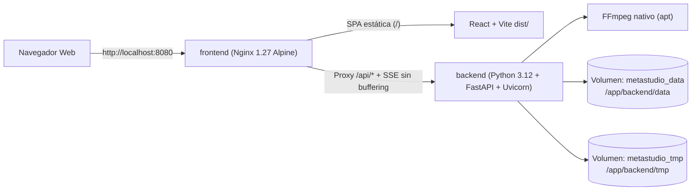

# Guía de Despliegue con Docker — MetaStudio Music Downloader

Esta guía describe cómo construir, ejecutar, configurar y mantener **MetaStudio Music Downloader** utilizando **Docker** y **Docker Compose**.

---

## 1. Arquitectura de Contenedores

El despliegue con `docker-compose.yml` levanta dos servicios conectados a través de una red privada (`metastudio-net`):



| Servicio | Imagen Base | Puerto Interno | Puerto Host (por defecto) | Responsabilidad |
| --- | --- | --- | --- | --- |
| `frontend` | `node:22-alpine` → `nginx:1.27-alpine` (multi-stage) | `80` | `8080-8099` (`FRONTEND_PORT`, elige el primer puerto libre) | Sirve la SPA compilada y actúa como reverse proxy hacia `/api/*` (con soporte dedicado para SSE y subidas de carátulas hasta 30 MB). |
| `backend` | `python:3.12-slim` + `ffmpeg` | `8000` | `8000-8019` (`BACKEND_HOST_PORT`, elige el primer puerto libre) | Ejecuta FastAPI, `yt-dlp`, FFmpeg nativo, Mutagen (ID3v2.3), Pillow y la cola asíncrona de descargas/ZIP. |

### Decisiones Clave de Contenerización

- **FFmpeg nativo del sistema**: `backend/Dockerfile` instala `ffmpeg` (y `ffprobe`) vía `apt-get`, por lo que el servicio detecta automáticamente `/usr/bin/ffmpeg` (`source: "system_path"`) sin depender de rutas locales del host. `docker-compose.yml` fija `FFMPEG_PATH: ""` para evitar conflictos si `.env` contiene una ruta de Windows/macOS.
- **Usuario no-root en Backend**: El contenedor `backend` se ejecuta como `appuser` (UID `1000`) con permisos dedicados sobre `/app/backend/data` y `/app/backend/tmp`.
- **Worker único asíncrono**: Uvicorn arranca con un único worker asíncrono (`--proxy-headers --forwarded-allow-ips=*`) para mantener la coherencia en memoria de sesiones activas, cola de descargas y suscripciones **Server-Sent Events (SSE)**, respetando además la IP real del cliente detrás de Nginx para el rate-limiter.
- **Proxy Nginx preparado para SSE y ZIP**: `frontend/nginx.conf` desactiva el buffering y la compresión gzip en `/api/v1/jobs/<id>/events` con timeout extendido (`3600s`) para streaming en tiempo real de playlists largas, y permite subidas de carátulas personalizadas de hasta `30m`.
- **Same-origin sin problemas de CORS**: El frontend se compila con `VITE_API_BASE_URL=""` por defecto para que todas las llamadas a `/api/v1/*` pasen por el proxy de Nginx en el mismo origen.
- **Healthchecks y arranque ordenado**: `frontend` espera a que `backend` supere su healthcheck (`GET /api/v1/health`) antes de iniciar.

---

## 2. Requisitos Previos

- **Docker Engine 24+** y **Docker Compose v2** (`docker compose`).
  - Windows / macOS: [Docker Desktop](https://www.docker.com/products/docker-desktop/) en ejecución.
  - Linux: Docker Engine + plugin `docker-compose-plugin`.

---

## 3. Inicio Rápido con Docker Compose

### Opción A: Arrancar directamente (sin archivo `.env`)

`docker-compose.yml` incluye valores por defecto seguros y no exige `.env` (MusicBrainz, Deezer e iTunes funcionan sin claves):

```bash
docker compose up --build -d
```

### Opción B: Con configuración personalizada (Discogs / puertos)

```bash
# 1. Copiar plantilla de entorno
cp .env.example .env

# 2. Editar .env (opcional: DISCOGS_TOKEN, FRONTEND_PORT, etc.)

# 3. Construir e iniciar los contenedores en segundo plano
docker compose up --build -d
```

### URLs disponibles

Docker asigna automáticamente el primer puerto libre dentro del rango (`8080-8099` para el frontend y `8000-8019` para el backend). Para ver el puerto exacto asignado:

```bash
docker compose port frontend 80
docker compose port backend 8000
```

- **Aplicación Web (Frontend + Proxy API)**: `http://localhost:<puerto-frontend>` (p. ej. `http://localhost:8080`, o `http://localhost:8081` si el `8080` está ocupado)
- **Healthcheck Backend**: `http://localhost:<puerto-backend>/api/v1/health`
- **Documentación OpenAPI / Swagger**: `http://localhost:<puerto-backend>/docs`

---

## 4. Variables de Entorno Relevantes en Docker

Todas las variables de `.env` son opcionales y pueden sobrescribirse mediante `.env` o variables de entorno del host:

| Variable | Valor por defecto en Docker | Descripción |
| --- | --- | --- |
| `FRONTEND_PORT` | `8080-8099` | Puerto o rango de puertos del host para Nginx (si un puerto está ocupado pasa al siguiente libre) |
| `BACKEND_HOST_PORT` | `8000-8019` | Puerto o rango de puertos del host para FastAPI (si un puerto está ocupado pasa al siguiente libre) |
| `CORS_ORIGINS` | `http://localhost:8080,http://127.0.0.1:8080,http://localhost:5173,http://127.0.0.1:5173` | Orígenes CORS aceptados si se consume la API directamente |
| `AUDIO_MP3_BITRATE` | `320` | Bitrate MP3 de exportación (`96`–`320` kbps) |
| `PLAYLIST_DOWNLOAD_CONCURRENCY` | `2` | Concurrencia en descargas de playlists (`1`–`5`) |
| `MAX_ARTWORK_UPLOAD_MB` | `10` | Límite de subida de carátula personalizada (`1`–`25` MB) |
| `RATE_LIMIT_PER_MINUTE` | `60` | Límite de peticiones API por minuto e IP |
| `MUSICBRAINZ_USER_AGENT` | `MetaStudio/1.0.0 (...)` | User-Agent enviado a MusicBrainz |
| `DISCOGS_TOKEN` | *(vacío)* | Token opcional para activar el proveedor Discogs |

---

## 5. Persistencia y Volúmenes

Docker Compose crea dos volúmenes gestionados:

| Volumen | Ruta en el contenedor | Contenido |
| --- | --- | --- |
| `metastudio_data` | `/app/backend/data` | Persistencia independiente de etiquetas (`track_tags.json`) y etiquetas personalizadas del catálogo (`custom_tags.json`). Se conserva entre reinicios y reconstrucciones. |
| `metastudio_tmp` | `/app/backend/tmp` | Archivos temporales aislados por sesión (caché, carátulas subidas, MP3 descargados y archivos ZIP). |

Para limpiar únicamente los datos temporales y empezar en limpio (borrando también etiquetas guardadas si se usa `-v`):

```bash
# Detener manteniendo volúmenes y etiquetas guardadas
docker compose down

# Detener y eliminar también los volúmenes de datos/temporales
docker compose down -v
```

---

## 6. Comandos Operativos Frecuentes

```bash
# Ver estado y salud (healthy) de los contenedores
docker compose ps

# Seguir logs en tiempo real de ambos servicios
docker compose logs -f

# Ver solo los logs del backend (yt-dlp, FFmpeg, API)
docker compose logs -f backend

# Ejecutar la suite de pruebas y linter dentro del contenedor backend
docker compose exec backend pytest backend/tests/ -v
docker compose exec backend ruff check backend

# Actualizar yt-dlp reconstruyendo la imagen del backend sin caché
docker compose build --no-cache backend
docker compose up -d backend
```

---

## 7. Solución de Problemas en Docker

- **Todo el rango de puertos (`8080-8099` u `8000-8019`) está ocupado o quieres un puerto fijo**: Define `FRONTEND_PORT=3000` o `BACKEND_HOST_PORT=8050` en `.env` y vuelve a ejecutar `docker compose up -d`. Para consultar qué puerto del rango fue asignado automáticamente, ejecuta `docker compose ps` o `docker compose port frontend 80`.
- **Error `open //./pipe/dockerDesktopLinuxEngine`**: El motor de Docker Desktop no está iniciado. Abre Docker Desktop y espera a que muestre el estado *Engine running*.
- **Error al descargar de YouTube tras varias semanas**: Reconstruye el backend sin caché (`docker compose build --no-cache backend && docker compose up -d backend`) para obtener la versión más reciente de `yt-dlp`.
- **Despliegue detrás de otro proxy inverso (Traefik, Caddy, Cloudflare Tunnel)**: Asegúrate de desactivar el buffering de respuesta en la ruta `/api/v1/jobs/*/events` para que el progreso SSE se entregue en tiempo real.
